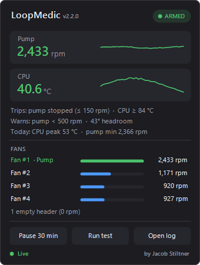

# LoopMedic

**Powers your PC off if your AIO pump stops, before the CPU cooks.**

<p align="center"></p>

LoopMedic runs quietly in the background from startup. Every 2 seconds it reads the pump speed
(from the motherboard fan header the pump's speed cable plugs into) and the CPU temperature.

| When...                                     | for...                   | then...                                                                 |
|---------------------------------------------|--------------------------|-------------------------------------------------------------------------|
| the pump has **stopped** (150 rpm or less)  | 10 s                     | an alarm with a 30 s countdown; if nobody chooses, the PC powers off (5 s if the CPU is already over its limit) |
| the CPU is at or above its limit            | 30 s (60 s on some chips) | same                                                                    |
| the pump is **slower** than usual (under 500 rpm, but spinning) | 10 s | a warning only - the PC is not powered off for this                 |

A tray icon shows it's working, with live pump, CPU and fan readings. It never changes a fan or pump
speed and leaves your cooler's own app alone. It runs a self-check at every boot and a self-test once a
month, and after a forced power-off it tells you why the PC turned off.

> **No warranty.** LoopMedic is an *extra* layer of protection, not a replacement for the ones your PC
> already has (BIOS fan-fail and temperature shutdowns, the CPU's own thermal limits). It can miss a
> failure, and it can power your PC off when nothing is wrong. Use it at your own risk; see
> [LICENSE.md](LICENSE.md).

## Download

Get the latest package from the [Releases](../../releases) page:

- **Windows 10 / 11:** `LoopMedic.zip` - unzip, run `Install.bat`, follow the setup.
  Read [windows/package/README.txt](windows/package/README.txt) first.
- **Linux (systemd):** `LoopMedic-Linux.tar.gz` - unpack, run `bash install.sh` as your normal user (it asks for your password when it needs it).
  Read [linux/README.txt](linux/README.txt) first.

## What's in this repo

```
windows/   C# watchdog (src/), tray app (tray/), installer + setup scripts, tests
           built on your PC by build.ps1 with the .NET Framework compiler that ships with Windows
linux/     Python (standard library) watchdog as a systemd service, PySide6 tray app, setup, tests
tools/     pack-release.py - builds both release packages; panel-screenshot.py - docs/panel.png on made-up
           sensor values; real-tests/ - real power-off and pop-up tests (admin)
```

Both versions share the same version numbers, rules and CPU limit table (`cpu-limits.json`).
How the Windows version is put together, including its threat model:
[windows/ARCHITECTURE.md](windows/ARCHITECTURE.md).

### Building from source

- **Windows:** put the [LibreHardwareMonitorLib](https://github.com/LibreHardwareMonitor/LibreHardwareMonitor)
  0.9.6 DLLs in `windows/lhm/` and the signed [PawnIO](https://pawnio.eu) installer in
  `windows/package/pawnio/`, then run `windows/build.ps1`. `windows/tests/run-tests.py` runs the
  test scenarios against the built exe (simulated sensors, never powers off).
- **Linux:** nothing to build. `linux/tests/run-tests.py` runs the test scenarios.
- **Release packages:** `python tools/pack-release.py [output folder]`.

## License

[PolyForm Noncommercial 1.0.0](LICENSE.md) - free to use, change and share for any noncommercial
purpose. Commercial use needs the author's permission.

Third-party parts (LibreHardwareMonitorLib, PawnIO) keep their own licenses; see
[windows/package/THIRD-PARTY-NOTICES.txt](windows/package/THIRD-PARTY-NOTICES.txt).
